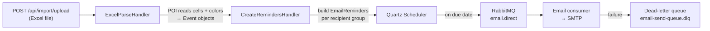

# Release Calendar Automation — Backend

Spring Boot service that turns a treasury's **yearly planning spreadsheet** into a live release calendar and **automated email reminders**.

Operations teams used to track release windows, freeze periods and high-load days manually in a color-coded Excel file. This service ingests that file, interprets the cell colors into typed calendar events, and schedules reminder emails so the right people are warned before each critical day — no manual follow-up.

> Built as a summer internship project at Yapı Kredi Teknoloji (Treasury Analytics).

---

## What it does

1. **Upload** the planning Excel (`POST /api/import/upload`).
2. **Parse** it with Apache POI — each cell's **color is mapped to an event type** (e.g. red → freeze, green → release, yellow → busy day).
3. **Create events** for every marked day (`FREEZE`, `RELEASE`, `BUSY_DAY`, `IMPORTANT_PATCH`, `IMPORTANT_DRC`), grouped under the import batch they came from.
4. **Generate reminders** for each event, targeting the configured recipient groups and email templates.
5. **Schedule & send** — Quartz fires reminders on their due date, publishing to RabbitMQ; a consumer sends the email and updates its status (`PENDING → SENT / FAILED`), with failures routed to a dead-letter queue.

---

## Import pipeline (Chain of Responsibility)

The upload flow is a handler chain, so each step is isolated and the pipeline is easy to extend:

`DefaultImportChainFactory` builds the chain (`ExcelParseHandler → CreateRemindersHandler`) around a shared `ImportContext`.

---

## Reliable email delivery (RabbitMQ)

| Component | Value |
|---|---|
| Exchange | `email.direct` (direct) |
| Queue | `email-send-queue.v2` (routing key `email.send`) |
| Dead-letter exchange | `email.dlx` |
| Dead-letter queue | `email-send-queue.dlq` (routing key `email.send.dlq`) |

Messages that keep failing are dead-lettered instead of lost, and each reminder carries a status (`PENDING`, `SENT`, `FAILED`, `CANCELLED`) so delivery is auditable.

---

## Domain model

| Entity | Purpose |
|---|---|
| `ImportBatch` / `ImportBatchEvent` | One Excel upload and the events extracted from it |
| `Event` | A calendar day with a type and criticality |
| `Color` | Maps an Excel cell color to an event type |
| `EmailReminder` | A scheduled reminder for an event (has a `ReminderStatus`) |
| `EmailTemplate` | Reusable email body/subject templates |
| `RecipientGroup` / `RecipientGroupMember` | Who gets notified |
| `User` | Application users (secured with Spring Security) |

Enums: `EventType` (FREEZE, RELEASE, BUSY_DAY, IMPORTANT_PATCH, IMPORTANT_DRC) · `CriticalityLevel` (LOW, MEDIUM, HIGH) · `ReminderStatus`.

---

## Tech Stack

**Java 21 · Spring Boot 3** — Spring Web, Spring Data JPA, Spring AMQP (RabbitMQ), Spring Mail, Spring Security, Validation
**Scheduling:** Quartz
**Excel:** Apache POI (`poi-ooxml`)
**Data & messaging:** MySQL · RabbitMQ
**Docs:** springdoc-openapi (Swagger UI)
**Other:** Lombok · Maven · Docker

---

## API

- `POST /api/import/upload` — multipart Excel upload; runs the import pipeline.
- Swagger UI available at `/swagger-ui.html` once running.

## Security Notes

This started as a learning project; before any further use:

- **Remove hard-coded credentials.** `application.properties` currently contains a real MySQL password and a mail placeholder committed to the repo — move all secrets to environment variables and **rotate the database password**, since it remains in git history.
- Restrict the Swagger UI and the upload endpoint behind authentication in non-dev environments.
